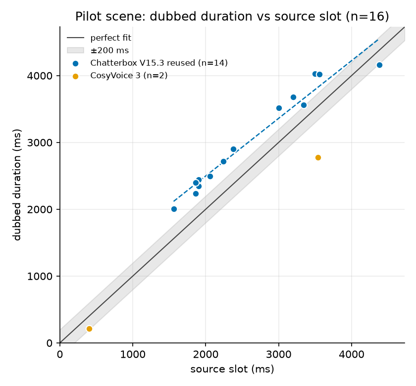
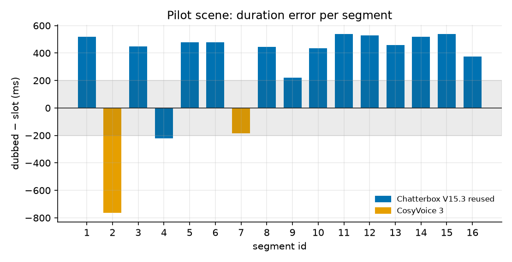
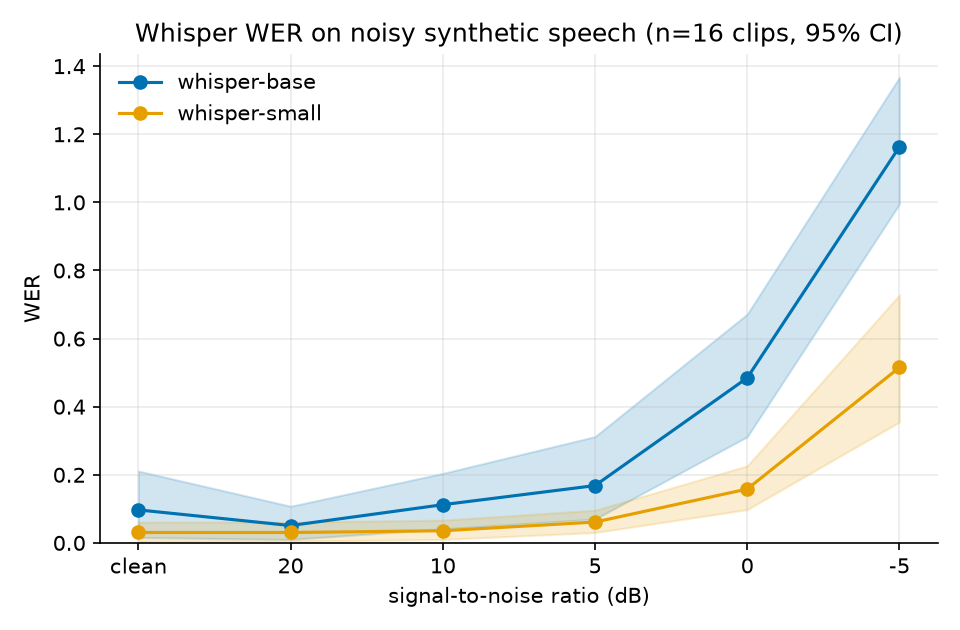
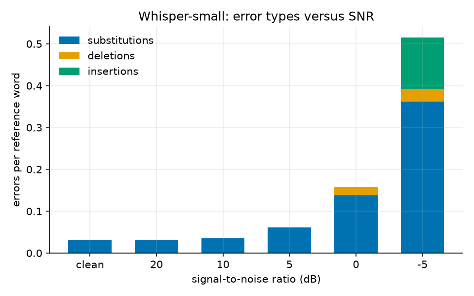
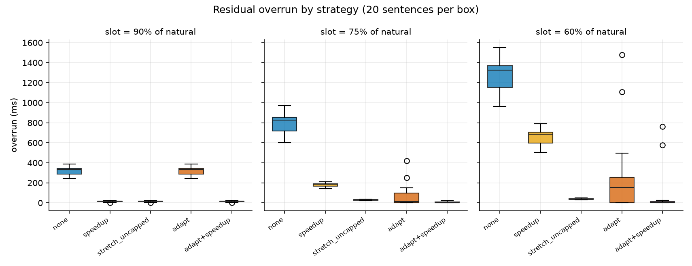
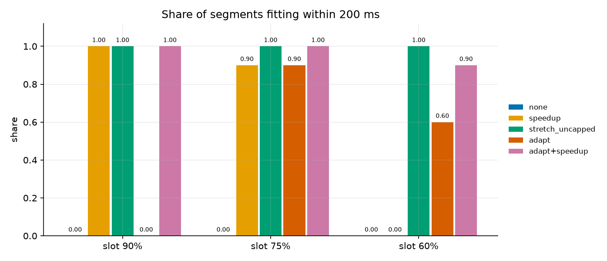
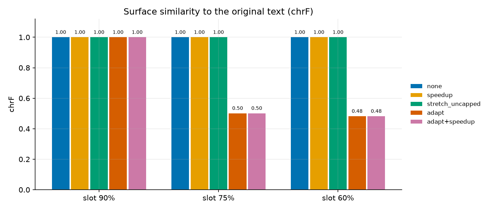
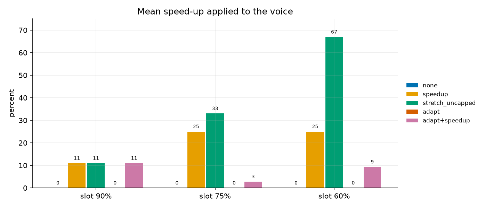

# Results

Generated by `experiments/make_results_md.py` from the JSON files in this folder. All studies are **pilots**: small samples, synthetic data, one language pair. Read each caveat before drawing a conclusion.

## 1. Timing pilot (original pipeline, one scene)

n = 16 segments; tolerance 200 ms. *one scene, 16 segments; engine confounded with character and with the adaptation loop.*

| group | n_segments | n_overrun | overrun_rate | mean_overrun_ms | max_overrun_ms | median_ratio |
|---|---|---|---|---|---|---|
| all | 16 | 13 | 0.812 | 460.615 | 540 | 1.187 |
| Chatterbox V15.3 reused | 14 | 13 | 0.929 | 460.615 | 540 | 1.207 |
| CosyVoice 3 | 2 | 0 | 0.000 | 0.000 | 0.000 | 0.659 |

Descriptive least-squares fit, dubbed duration = slope x slot + intercept:

| engine | n | slope | intercept | r2 |
|---|---|---|---|---|
| Chatterbox V15.3 reused | 14 | 0.863 | 771.564 | 0.954 |

## 2. ASR robustness to white noise (synthetic speech)

8 sentences x 2 voices; seed 20261. *synthetic speech + white Gaussian noise, 16 clips, French only; not representative of real dubbing audio (music, effects); S/D/I split is one of several equal-cost alignments.*

| model | snr | n_clips | WER [95% CI] | CER | S_rate | D_rate | I_rate | n_perfect |
|---|---|---|---|---|---|---|---|---|
| base | clean | 16 | 0.097 [0.016, 0.211] | 0.036 | 0.077 | 0.000 | 0.020 | 10 |
| base | 20 | 16 | 0.051 [0.010, 0.108] | 0.023 | 0.046 | 0.000 | 0.005 | 11 |
| base | 10 | 16 | 0.112 [0.041, 0.204] | 0.048 | 0.082 | 0.010 | 0.020 | 8 |
| base | 5 | 16 | 0.168 [0.070, 0.312] | 0.073 | 0.122 | 0.010 | 0.036 | 5 |
| base | 0 | 16 | 0.485 [0.312, 0.672] | 0.256 | 0.372 | 0.020 | 0.092 | 1 |
| base | -5 | 16 | 1.163 [0.995, 1.367] | 0.643 | 0.770 | 0.005 | 0.388 | 0 |
| small | clean | 16 | 0.031 [0.005, 0.061] | 0.020 | 0.031 | 0.000 | 0.000 | 12 |
| small | 20 | 16 | 0.031 [0.005, 0.061] | 0.020 | 0.031 | 0.000 | 0.000 | 12 |
| small | 10 | 16 | 0.036 [0.010, 0.067] | 0.021 | 0.036 | 0.000 | 0.000 | 11 |
| small | 5 | 16 | 0.061 [0.030, 0.096] | 0.030 | 0.061 | 0.000 | 0.000 | 8 |
| small | 0 | 16 | 0.158 [0.098, 0.226] | 0.097 | 0.138 | 0.020 | 0.000 | 3 |
| small | -5 | 16 | 0.515 [0.355, 0.728] | 0.307 | 0.362 | 0.031 | 0.122 | 0 |

## 3. Duration-fitting strategies (controlled slots)

20 sentences, LLM `qwen3:4b-instruct-2507-q4_K_M`, voice `fr-FR-DeniseNeural`, tolerance 50 ms; LLM calls 80 (80 from cache). *synthetic slots (ratio x natural duration), one voice, one small LLM; chrF is a surface proxy, not meaning preservation; the LLM's own semantic score is not validated; no human ratings.*

### Slot = 90% of the natural duration

| strategy | n | overrun_mean_ms | overrun_median_ms | fit_within_200ms | mean_rate_applied | share_beyond_natural_rate | adapted_rate | chrf_mean | numbers_kept_rate |
|---|---|---|---|---|---|---|---|---|---|
| none | 20 | 319.650 | 331.000 | 0.000 | 0 | 0.000 | 0.000 | 1.000 | 1.000 |
| speedup | 20 | 15.650 | 17.000 | 1.000 | 11 | 0.000 | 0.000 | 1.000 | 1.000 |
| stretch_uncapped | 20 | 15.650 | 17.000 | 1.000 | 11 | 0.000 | 0.000 | 1.000 | 1.000 |
| adapt | 20 | 319.650 | 331.000 | 0.000 | 0 | 0.000 | 0.000 | 1.000 | 1.000 |
| adapt+speedup | 20 | 15.650 | 17.000 | 1.000 | 11 | 0.000 | 0.000 | 1.000 | 1.000 |

### Slot = 75% of the natural duration

| strategy | n | overrun_mean_ms | overrun_median_ms | fit_within_200ms | mean_rate_applied | share_beyond_natural_rate | adapted_rate | chrf_mean | numbers_kept_rate |
|---|---|---|---|---|---|---|---|---|---|
| none | 20 | 799 | 827.000 | 0.000 | 0 | 0.000 | 0.000 | 1.000 | 1.000 |
| speedup | 20 | 181 | 186.000 | 0.900 | 25 | 0.000 | 0.000 | 1.000 | 1.000 |
| stretch_uncapped | 20 | 29.500 | 30.000 | 1.000 | 33 | 1.000 | 0.000 | 1.000 | 1.000 |
| adapt | 20 | 66.350 | 12.500 | 0.900 | 0 | 0.000 | 1.000 | 0.502 | 1.000 |
| adapt+speedup | 20 | 4.200 | 0.000 | 1.000 | 2.800 | 0.000 | 1.000 | 0.502 | 1.000 |

### Slot = 60% of the natural duration

| strategy | n | overrun_mean_ms | overrun_median_ms | fit_within_200ms | mean_rate_applied | share_beyond_natural_rate | adapted_rate | chrf_mean | numbers_kept_rate |
|---|---|---|---|---|---|---|---|---|---|
| none | 20 | 1278.600 | 1324.000 | 0.000 | 0 | 0.000 | 0.000 | 1.000 | 1.000 |
| speedup | 20 | 660.600 | 684.000 | 0.000 | 25 | 0.000 | 0.000 | 1.000 | 1.000 |
| stretch_uncapped | 20 | 37.600 | 38.000 | 1.000 | 67 | 1.000 | 0.000 | 1.000 | 1.000 |
| adapt | 20 | 262.700 | 156.000 | 0.600 | 0 | 0.000 | 0.900 | 0.482 | 1.000 |
| adapt+speedup | 20 | 71.900 | 4.000 | 0.900 | 9.350 | 0.000 | 0.900 | 0.482 | 1.000 |

### Repeat run

The study was run twice, with the number guard fixed in between. 2 of 300 trials ended with a different text; they come from 1 sentence and slot combination(s): [(3, 0.6)] (sentence index, slot ratio).
For that one, the rewritten candidate sits exactly at the 25 % speed-up limit, and five identical syntheses of it lasted 2780, 2780, 2780, 2780 and 2790 ms. With a 2220 ms slot, 2780 ms needs +25 % (accepted) and 2790 ms needs +26 % (rejected). A 10 ms jitter flipped the decision, so a hard limit makes single outcomes fragile.

Tables above are from the final run.

| ratio | strategy | overrun_mean_ms first | overrun_mean_ms final | fit<=200ms first | fit<=200ms final |
|---|---|---|---|---|---|
| 0.750 | adapt | 65.850 | 66.350 | 0.900 | 0.900 |
| 0.750 | adapt+speedup | 4.450 | 4.200 | 1.000 | 1.000 |
| 0.600 | stretch_uncapped | 37.100 | 37.600 | 1.000 | 1.000 |
| 0.600 | adapt | 216.700 | 262.700 | 0.600 | 0.600 |
| 0.600 | adapt+speedup | 35.400 | 71.900 | 0.950 | 0.900 |

## 4. End-to-end smoke test (real Whisper, Ollama and edge-tts)

strategy `adapt+speedup`; 3 segments from a generated Japanese clip.

| id | target_ms | final_duration_ms | overflow_ms | rate_applied | adapted |
|---|---|---|---|---|---|
| 1 | 2920 | 2580 | 0 | 0 | False |
| 2 | 3520 | 2610 | 0 | 0 | False |
| 3 | 2760 | 2260 | 0 | 0 | False |
